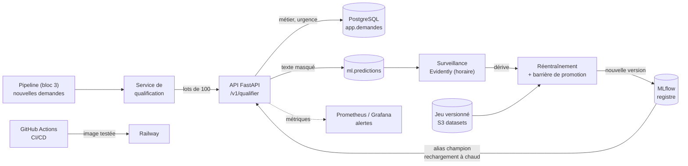

# Artelio — Qualification des demandes par IA (MLOps)

Une IA qui lit la demande d'un client (« fuite sous l'évier, ça coule partout ») et prédit le **métier** et
l'**urgence**, avec une explication et une revue humaine quand elle doute, industrialisée de bout en bout :
API, CI/CD, registre de modèles, surveillance de la dérive et réentraînement automatique.

> Certification « Architecte en Intelligence Artificielle » — **Bloc 4 : construire, déployer et piloter des solutions
> d'IA**. S'appuie sur la plateforme (bloc 2) et les pipelines (bloc 3). Données synthétiques.

| Document | Contenu |
|---|---|
| [Cahier des charges](docs/CAHIER_DES_CHARGES_IA.md) | Besoin, critères d'acceptation, accessibilité, exploitation, conformité |
| [Notebook d'analyse](notebooks/01_exploration_modelisation.ipynb) | Données, piège des gabarits, v1 → v3, intervalles de confiance, calibration, robustesse, équité, explicabilité, erreurs |
| [Fiche modèle](docs/MODEL_CARD.md) | Usage, performances, limites, risques |
| [Architecture MLOps](docs/ARCHITECTURE_MLOPS.md) | Composants, cycle de vie du modèle, CI/CD, surveillance, réentraînement |
| [Données](data/README.md) | Les trois jeux d'évaluation et leurs biais |

## Résultats en bref

| Sur des textes jamais vus (test final) | Champion |
|---|---|
| F1 macro métier | **0,78** (IC 95 % : 0,68 – 0,86) |
| F1 macro urgence | **0,64** (IC 95 % : 0,53 – 0,74) |
| Urgences critiques détectées | **79 %** ; sous-estimation grave **1,1 %** |
| Exactitude quand la décision est automatique | **87,5 %** (le reste part en revue humaine) |

Modèle : TF-IDF (mots + caractères) **et** plongements de phrases (MiniLM multilingue), régression logistique,
garde-fous sur les signaux de danger. Pourquoi ces choix, et pourquoi la validation croisée à 1,00 ne veut rien dire
ici : voir le notebook.

## Architecture



## Démarrage

**Prérequis :** plateforme (bloc 2) et pipelines (bloc 3) déployés, Docker, Terraform.

```bash
./scripts/configure_env.sh                # secrets de la plateforme → .env (non versionné)
docker compose build                      # images "ml" et "api" (modèle de plongements inclus)
docker compose up -d mlflow
docker compose run --rm entrainement      # sélection, évaluation, enregistrement → alias « champion »
docker compose up -d                      # API, qualification, surveillance, réentraînement
```

| Interface | Adresse |
|---|---|
| API (documentation interactive) | http://localhost:18000/docs — clé : `./scripts/api_key.sh` (en-tête `X-API-Key`) |
| MLflow (expériences, registre) | http://localhost:15000 |
| Grafana → « IA de qualification Artelio » | http://localhost:13000 |

```bash
curl -s -X POST localhost:18000/v1/qualifier -H "X-API-Key: $(./scripts/api_key.sh)" -H 'Content-Type: application/json' \
     -d '{"texte": "Ma fille de 6 ans est restée enfermée dans la salle de bain", "canal": "telephone"}'
```

## Démonstrations

| Commande | Ce qu'elle prouve |
|---|---|
| `docker compose exec -e API_KEY=$(./scripts/api_key.sh) planificateur python scripts/demo_derive.py` | **Dérive** : 600 demandes « vague de froid + nouveaux équipements » → Evidently détecte la dérive → réentraînement automatique → nouvelle version → l'API la charge à chaud |
| MLflow → modèle `artelio-qualifieur` | **Registre** : versions, alias `champion` / `challenger`, raison des refus de promotion |
| `pytest -m champion` | **Barrière de qualité** du modèle livré (planchers, sous-estimation des urgences, robustesse) |

## Structure

```
artelio-ia/
├── src/artelio_ia/       Modèle, données, évaluation, entraînement, registre, garde-fous, enrichissement, qualification
├── api/                  API FastAPI (sécurité, métriques, journal des prédictions)
├── monitoring/           Surveillance de la dérive (Evidently) et de la performance réelle
├── retrain/              Planificateur : surveillance horaire, réentraînement automatique
├── notebooks/            Analyse complète (exécutée)
├── models/champion/      Modèle livré (artefact + métadonnées + évaluation), utilisé par l'image Railway
├── data/                 Jeux d'évaluation hors gabarits (validation, test final)
├── tests/                46 tests : modèle, garde-fous, évaluation, données, registre, API, barrière de qualité
├── k8s/                  Manifestes Kubernetes (cible alternative)
├── .github/workflows/    CI (qualité, tests, barrière modèle, image, Trivy) et CD (Railway)
├── docker/ml/Dockerfile  Image d'entraînement et d'exploitation MLOps
├── Dockerfile            Image de l'API
└── docker-compose.yml
```
